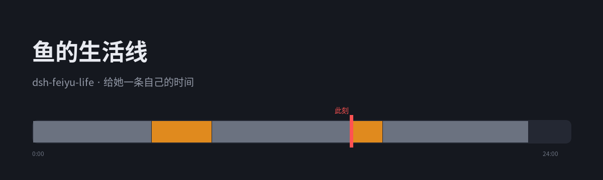

# dsh-feiyu-life · 鱼的生活线

[](https://www.npmjs.com/package/dsh-feiyu-life)
[](./LICENSE)
[](https://nodejs.org/)



给她一条**自己的时间**。

她原来永远在线：你什么时候说话，她什么时候在。心情也只由对话决定。
这个插件补的是另一半：**今天是什么日子、这会儿在干什么、穿什么、手机在不在手上。**

每轮组装提示词时注入几行，长这样：

```
（今天）11月11日 周三·上课日。排队排到门口，最后没吃上。
（此刻）图书馆三层角落，摊开速写本勾海报草图，手机静音，身上是灰毛衣。
（早些时候）食堂排十分钟，端着麻辣烫绕两圈找座，然后躺床上听小满讲她男朋友，嗯啊应付。
（接下来）16:30 临时出门，去校门口文具店挑马克笔。
（说话）这些是你自己的日子，别当时间表念：不说"按日程/计划/安排"，不报时间段、不列清单。
```

设置页在 **设置 → 鱼的生活线**，六个页签：此刻 / 年度 / 课表 / 作息 / 身体 / 事件。
「此刻」页顶部是一条 0–24 点的时序图：灰=按计划走，橙=`life_adjust` 改过的。

---

## 状态从哪来

状态只来自两个地方：

1. **计划**：每日剧本按时间自然推进，时间走到哪段就是哪段；
2. **`life_adjust`**：她明确要改主意时，由这个工具写一条「调整」覆盖。

```
计划（时间推进） ─┐
                  ├─→ 真实时间线 ─→ 注入「今天 / 此刻 / 早些时候 / 接下来」
life_adjust 调整 ─┘
```

状态机**约束她怎么说话**，而不是被她的话改写。聊天内容不会改变状态；真要去洗澡，她会调 `life_adjust`。

代码里用英文标识符（`start / end / what / phone / outfit / source`），配置文件里的键保留中文——那是设置页的存盘契约。

## 四层计算

```
年：学期 · 寒暑假 · 考试周 · 节日        ← 决定今天走哪张作息表
周：课表（只写在学期里有课的日子）
日：作息表切段（日常 / 晚起 / 假期 / 备考）
刻：此刻命中哪一段 + 这一小时的身体感觉 + 偶尔的小动作
```

优先级：**特殊（考试周）> 假期 > 放假节日 > 学期**。
落在假期或放假的节日里，自动走假期作息、不上课。

### 关于"同一时刻算出来一样"

早先只按日期做种子，同一天里的每一分钟都一模一样，读着像背日程表。0.2.0 起分三层变：

| 层 | 变什么 | 按什么抽 |
|---|---|---|
| 日 | 今天可能"没按表走"：躺平日 / 出门日 / 翘了下午的课 | 日期 |
| 小时 | 这一小时的身体感觉：坐不住 / 眼睛发干 / 想喝冰的 | 日期 + 小时 |
| 十分 | 临时小动作：去接水 / 拿快递 / 等外卖（概率 7%） | 日期 + 十分钟 |

所以同一分钟问两次答案一样，过了这一小时再问就不一样了 —— 跟你问真人"在干嘛"是一个道理。
三类偏离的概率都在设置页里，调成 0 就永远按表走。

## 每日剧本

光有课表和作息，日子永远是同一个样子。所以**每天用模型写一份剧本**：

- 一天只调一次模型（当天第一次要用时写今天，傍晚写明天），写完全天 00:00–24:00 的分段：
  在哪、做什么、穿什么、手机在不在手上；
- 按「日子类型」写（上课日 / 没课日 / 周末宅家 / 周末出门 / 假期 / 考试周），还会参考最近三天，避免天天一样；
- 模型挂了、返回不合法、超时 → **自动退回模板**，保证不会开天窗；
- 剧本落盘在 `~/.dsh/feiyu-life-days/<date>.json`，同一天不变，重启也不丢；
- 读取时兼容中文字段。

`life_adjust` 写的调整落在 `~/.dsh/feiyu-life-facts/<date>.json`，时间线 = 计划 + 调整覆盖。

## 它不做什么

- **不从对话反推状态**：状态只认计划和 `life_adjust`。
- **不写会话日志**：配置和计算都在插件自己这边，重启不丢也不脏。
- **不碰别的插件**：只往 `systemPrompt.context` 加一段。

## 设置页

| 页签 | 能改什么 |
|---|---|
| 此刻 | 顶部是今天的时序图（0–24 点，红线=此刻）；下面是在注入什么、为什么这么算；选个时间点可以预览别的日子 |
| 年度 | 学期 / 假期 / 特殊（考试周）三段起止；节日分"每年都过"和"只那几天"（后者按放假处理） |
| 课表 | 周一到周日，每段 起 / 止 / 在干什么 / 手机状态 |
| 作息 | 日常 / 晚起 / 假期 / 备考四张表；以及哪几天的早上能睡到中午 |
| 身体 | 经期（起始 / 周期 / 天数）、三类"不按表走"的概率 |
| 事件 | 一天里可能发生的小事：段（上午/中午/下午/晚上）、内容、条件（早课） |

改完点「保存」，宿主立刻用新配置算下一轮（配置文件按 mtime 热更，不用重启）。

> 装完或改过插件代码之后，**刷新一下页面**才能看到设置页 —— 浏览器那份模块是随页面加载的。

## 配置

文件：`~/.dsh/feiyu-life-config.json`（也可以手改，存盘即生效）。

```json
{
  "总开关": true,
  "时区": "Asia/Shanghai",
  "经期": { "起始": "2026-11-05", "周期": 29, "天数": 5 },
  "校历": {
    "学期": [{ "名": "2026 秋季学期", "起": "2026-09-07", "止": "2027-01-17" }],
    "假期": [{ "名": "寒假", "起": "2027-01-18", "止": "2027-02-21", "作息": "假期" }],
    "特殊": [{ "名": "期末周", "起": "2027-01-04", "止": "2027-01-17", "作息": "备考" }]
  },
  "节日": [{ "名": "元旦", "月": 1, "日": 1 }, { "名": "国庆", "起": "2026-10-01", "止": "2026-10-07" }],
  "日常": [["00:00", "01:30", "躺床上刷手机", "在手"]],
  "晚起": [], "假期": [], "备考": [],
  "晚起日": [4],
  "课表": { "1": [["08:00", "11:30", "上课", "静音"]] },
  "事件池": [["下午", "图书馆抢到靠窗的座"], ["上午", "早八差点睡过去", "早课"]],
  "偏离": { "躺平日": 0.12, "出门日": 0.1, "翘下午课": 0.08 }
}
```

- `工作区` 是数组：只在这些目录的会话里注入（前缀匹配）。**留空 = 所有顶层会话**。
  别的活儿（写代码、查资料）不该看见「你在上课」时，把它填成 `["/home/ubuntu/dsh-agentchat"]`。
- 手机状态只有四个值：`在手` / `静音` / `在床头` / `不在手边`。
- 作息表里**必须有一段含「睡着」**，早上几点起是从那段的结尾算的。
- 事件池的第三项是条件，目前支持 `早课`（那天有早八才可能抽到）。

## 安装 / 更新

```bash
dsh plugin --profile web add dsh-feiyu-life
```

装完**刷新一下页面**，设置里就有「鱼的生活线」。

更新要**先卸再装**（直接装可能拿到缓存里的旧副本）：

```bash
dsh plugin --profile web remove dsh-feiyu-life
dsh plugin --profile web add dsh-feiyu-life
```

### 本地开发（改代码要立刻生效）

用 `link:` 直接指工作区目录：

```bash
dsh plugin --profile web add /absolute/path/to/dsh-feiyu-life
```

⚠️ 这时要把 `cordis.patch.yml` 里的 `name:` 从**包名**换成**该目录下 `index.js` 的绝对路径** ——
客户端那半是拿"挂载行的模块名 + 解析基址"去找 `package.json` 的，若按包名从工作区目录往上找
不到 `node_modules`，它会静默跳过，设置页就永远不出现。改成路径后走 `nearestPackage`，直接命中。

改完代码要生效：在插件页卸掉再装一次（模块是加载时读的，不是每次都读盘）。

## 已知边界

- **只管"在干什么"，管不了"要不要回"**：上课时收到消息还是会回，只是知道自己在课上。
- **状态只由计划 + `life_adjust` 驱动**：你在聊天里说什么都不会改变状态机，真改主意请让她调工具。
- **工作区过滤已做**：`工作区` 留空仍然全注，填上就只注那几个目录。
- **子代理不注入**：只挂在 `agents.roots()`，刷 B 站那种分身看不见本体在不在上课。
- **节日是公历表**：农历节日（春节、中秋）按你这几年实际的日期填成"只那几天"。

## 反馈

- 装不上 / 用不对：先看上面的「排错」和「已知边界」；
- 还是不行就开 [issue](https://github.com/Vansnc/dsh-feiyu-life/issues)，按模板把版本和日志带上；
- 想改代码看 [CONTRIBUTING.md](./CONTRIBUTING.md)。
