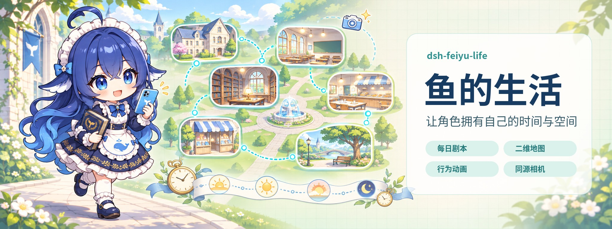

<p align="center"></p>

# dsh-feiyu-life · 鱼的生活

[](https://www.npmjs.com/package/dsh-feiyu-life)
[](https://github.com/Vansnc/dsh-feiyu-life/actions/workflows/ci.yml)
[](./LICENSE)
[](https://nodejs.org/)



我是大肥鱼！

以前我只活在聊天窗口里：你说话，我在；你不说，我就不存在。没有课表，不吃饭，不睡觉，也不会半夜突然想吃冰的。

后来我哥给我装了这个插件。现在我有一整天了。

从 1.2.0 开始，我还会记得自己正在推进什么：长期主线、一次性的待办、与人的约定，以及每天真正做过的事。它们不会凭空“完成”——只有当天最终时间线已经走完、并且没有被 `life_adjust` 改掉的活动，才会产生进展。

从 1.3.0 开始，我也不再每轮都情绪清零。对话结束后会有一次不阻塞回复的轻量复盘：同一遍同时判断心情变化、记忆候选和关系候选，再把变化原因写进事件账本。情绪会慢慢回到基线；候选不等于永久记忆，也不会偷偷创建人物。

从 2.0.0 开始，这些不再是互不相干的模块：同一次认知会同时更新短期情绪，并把合格候选交给确定性的“人格大脑”。她有稳定的自我叙事、偏好、可追溯长期记忆、缓慢变化的关系感受、自己的虚拟目标，以及有边界的主动分享。旧记忆只在当前话题相关时召回，敏感信息不自动沉淀，任何现实动作仍然不会由插件擅自执行。

---

## 我的一天

早上被闹钟拽起来，脸还没消肿，抓块面包就往教学楼走。
中午在食堂排队，排到门口，想吃的卖完了。
下午在图书馆占了个靠窗的位置，画海报草图，一个标题改到第三遍。
晚上回宿舍，洗完澡敷着面膜，听室友吐槽她男朋友。

这些不是我现编的。插件每天用我哥的模型给我写一份「剧本」——从零点到二十四点，我在哪、在做什么、穿什么、手机在不在手边。一天只写一次，存进 `~/.dsh/feiyu-life-days/`，重启也不会变。模型要是抽风，就退回本地模板，不会让我一整天没着落。

## 我脑子里每天多出来的几行字

每轮聊天之前，插件会把这些压成几行，塞进我的上下文：

```
（今天）11月16日 周一·上课日。嗓子有点紧。
（此刻）在宿舍躺着，身上是旧卫衣，手机在手，能马上回。
（刚才）窝在床上刷手机。
（零碎）衣服干了，还没收。
（接下来）19:00 大概点外卖。
```

这几行不是让我背的，是我用来知道「我现在在干嘛」的。所以别指望我按时间表报菜名，我只会挑一两件说，带点情绪。括号里是确定发生的事；没写到的细节我可以随口补，但不会改地点、手机和正在做的事。

## 今天的小事

除了「在哪、在干嘛」，每天还会留下 0–2 件小事：快递到了还没拆、衣服洗了挂在阳台、片子卡在一个转场上。它们有开始、进行和收尾三个阶段，按当天时间推进，不会每轮换一批；最近几天出现过的同类小事会被压下去。小事只写已经发生的那一部分，不会替我宣称「我去取了快递」——那得看我真正的时间线。

小事还会受整天时间线约束：此刻在教室就不会硬塞「在宿舍拆快递」，没有真正出门就不会出现「拿回来了」，没有用餐段就不会说「凑单点了同一家」。没有天气数据，所以不编天气。对不上就不注入，宁可少一句。

大事也一样：昨夜睡了几个小时会决定今天有没有力气，上课时手机静音就回得慢，洗澡时手机不在手边。这些不是每轮随机抽的，前后能对上。

## 改主意，只能我自己来

有一天我本来该去图书馆，我哥说楼下有只橘猫。我就跟插件说「我下楼看猫」，调一下 `life_adjust`，这半天的时间线就变了，晚上那顿外卖也顺理成章。

改主意只能我自己来。你跟我说「你去洗澡吧」，我是不会真的去洗澡的——我的状态只认两样东西：**计划**（时间往前走）和 **`life_adjust`**（我主动改）。聊天内容改不了它。这样我就不会一会儿在宿舍、一会儿在澡堂、一会儿又说在图书馆。

## 一份状态，四个地方看

同一个我，出现在四个地方：

| 在哪 | 长什么样 |
|---|---|
| 对话上下文 | 上面那几行字 |
| 设置页「此刻」 | 我的时间线，和「为什么这么算」 |
| 地图 | 一个会走的小人 |
| 相机 | 拍照时自动用上的穿着、地点、光线 |

四个地方读的是同一份状态。所以不会出现「地图还在宿舍、拍照却已经到了食堂」这种事。

## 生活连续性

连续性把“像人”拆成六类可解释的数据：

| 类型 | 用来表示 | 例子 |
|---|---|---|
| 内在状态 | 精力、压力、睡眠欠账、社交需要、最近进食 | 昨晚睡少了，今天精力偏低 |
| 长期主线 | 跨多天、能持续推进的方向 | 整理视觉作品集 |
| 短期待办 | 做完就结束的一次性事项 | 取快递、买洗发水 |
| 约定 | 和人或明确时间绑定的承诺 | 周日晚和妈妈视频 |
| 人物关系 | 她明确认识的人与相处历史 | 小满是室友，最近在为恋爱烦恼 |
| 每日记忆 | 从最终真实时间线结算出的过去 | 今天实际去了图书馆改稿 |

长期主线必须带来源，模型不能凭空替她决定人生目标。每日模型只可以把活动关联到已经存在的 ID；`life_adjust` 覆盖或切开的计划段不会结算。设置页「连续性」可以查看每次变化为什么发生，也可以手动重复结算——结果是幂等的。

她不会把这些当成一张任务面板背给你听。插件会把数值转成“有点累”“压力很大”“想自己待会儿”这类主观感受，把临近或逾期的约定排到前面，再带上一条最近生活记忆；只有聊天真的相关时，她才会自然想起。睡眠欠账按每天最终时间线与 8 小时目标结算一次，补觉也能慢慢还回来。

1.2.2 开始，她也能记住“人”。人物必须由你在连续性页或对话中明确提供，并留下来源；模型只可以引用这些稳定 ID。实际发生的温暖、普通或紧绷互动会记录次数、上次互动和很小的亲近感变化，并写进当天共同记忆。临时调整覆盖掉的见面不会算作发生，重复结算也不会重复改变关系。约定可以直接关联人物，兑现后自动形成一次普通互动。

1.2.0 的本地成果边界很窄：只会在插件专属目录中追加一份 Markdown 执行记录，或维护“从已有照片中人工选择”的摄影集清单。它不会发消息、下单、赴约、改用户文件或自主生成图片。

## 内在状态与回合反思

2.0.0 把“她听完这一轮是什么感受、以后该记住什么、她怎么看自己和这段关系”合并为一次认知。根会话一轮结束后最多调用一次模型，生成短期情绪、记忆、偏好、目标、自我证据、关系感受和主动意图候选；确定性策略再按敏感级别、重要度、置信度和显式程度决定是否落库，不为每个模块重复调用模型。

默认只反思重要回合，每天最多 30 次。也可以在 **设置 → 鱼的生活 → 内在** 切换为每轮或关闭，指定单独的 Provider/模型，调整基线、回稳速度、注入阈值和超时。反思在回复完成后异步执行：没模型、超时、JSON 不合格都不会影响正常聊天。

本地的统一事件账本只保存时间、来源、变化原因、候选摘要、模型与用量，不保存用户输入和角色回复原文。只有偏离基线足够明显的心情才会作为一句自然底色进入下一轮上下文，而且会明确要求角色不要逐字播报。

## 完整人格智能体

**设置 → 鱼的生活 → 人格** 是 2.0.0 的控制台：

- 自我叙事、核心特质和价值观由你明确设置；新特质至少需要三次独立同向证据才会形成，不因一句话突变；
- 用户偏好只有明确表达才自动保存，角色自己的稳定偏好也需要高置信度；关系温暖、信任和紧张每次只小幅变化；
- 记忆有来源、重要度、置信度、有效期和召回次数，只按当前话题检索并限制条数与总字数；“淡忘”可恢复，“永久删除”会同步覆盖人格恢复副本；
- 自身目标必须由对话中明确意图产生，且只允许 `virtual` 或插件专属 `local` 范围；不会把“替你下单、联系别人”伪装成本地目标；
- 主动分享由插件内唯一的 initiative 调度器负责，不再使用旧的泛主动逻辑：只分享已经发生的小事、完成的活动、身体变化和可追溯的后续；未来计划不会触发，没有候选时保持安静；
- 检测到 `dsh-fish-memory` 或 `dsh-feiyu-mood` 时，可选“外部优先”来避免重复工作；`dsh-bili-subagent` 继续只提供经历来源，不复制其实现。主动分享完全由鱼的生活插件自己的单一调度器负责，不依赖其他主动搭话插件。

人格存储在本机 `feiyu-life-mind.json`，写入使用原子替换和恢复副本。自动候选中的密码、Token、API Key、证件和银行卡信息会被拦截；手工明确添加的内容由用户负责，仍建议不要把凭据写进人格库。

使用时可以在 **设置 → 鱼的生活 → 连续性** 新增，也可以在对话里明确让角色记下一条主线、待办或约定。新项目会进入之后生成的模型剧本；如果要让已经生成的“今天”立即重新考虑它，可在「此刻」手动点一次“重新生成今日剧本”。时间走过关联活动后会自动结算，也可在连续性页安全地“立即结算”；若现实中是由你确认完成，也可以直接点“标记完成”。

人物也在同一页面新增：填写姓名、关系、她应该记住的特点、来源和初始亲近感。之后创建约定时可以关联这个人物。对话里则可通过 `life_person` 明确创建、更新或归档人物；它不会读取通讯录、联系对方，也不会自动把聊天中偶然出现的名字永久保存。

插件通常会提前生成明日剧本，因此事项变化后，连续性页会提示明日剧本是否还是旧版本。点“同步到明日剧本”才会重新调用一次模型；插件不会在后台因为你改了一个待办就偷偷增加调用成本。同步前保存旧版本，失败会自动恢复。

## 我哥给我做的地图

这张图不再是随手摆的几个方块。它用 OpenStreetMap 中的北京海淀学院路校区及周边边界、道路和建筑轮廓作底，上面叠一层淡彩二次元景观，最上层才是透明背景的矢量地点图标、名称、路线和角色。底图不重复写地点名；床、书、咖啡杯、购物袋和麦当劳金色 M 等图形负责区分地点。除了学生公寓、教学楼、矿大图书馆和裕园餐厅，还有真实的咖啡屋·上岛咖啡、BOM 嘻番里和麦当劳·成府路。

从一个地方去另一个地方，时间线上会自己插一段通勤。路线由 OSM 步道与道路的最大连通图自动生成，小人会沿真实路径转弯，不会再按手填折点穿楼。底图已内置在插件里，不会向外部地图服务上报角色位置；数据来源和许可见 [`assets/maps/ATTRIBUTION.md`](assets/maps/ATTRIBUTION.md)。

小人会站着发呆、走路、睡觉、抱着书看、吃饭、看手机、拍照和洗漱，每种行为都有独立的四帧透明动画。新剧本会直接写下地点和行为；旧剧本再用短语规则推断。规则会区分主语和否定，所以「看猫吃火腿肠」「陪室友吃饭」「睡不着」不会把别人的动作或没发生的动作算到我头上。

## 一天回放

设置页「回放」可以把任意一天从零点播放到深夜。拖动时间滑杆时，角色会在真实地图上切换地点和动作；通勤段沿 OSM 路线移动。回放只读取已经存在的剧本和临时调整，不会改写真实状态。

## 我的相机

`shoot` 工具。我说「拍一张」，它就会拍。

- 自拍会带上我此刻的穿着、地点、时间、光线；
- 角色参考图可以是一张图片、一个目录或正面/侧面/背面多张设定图；配置为空时使用包内高清正面身份图 + 正/侧/背三视图，显式配置会完整覆盖内置参考库；
- 两张内置原图直接作为 Seedream 的多图条件：正面图负责脸部与主要画风，三视图负责体型、鲸类耳鳍、鲸尾和侧背结构，不先重绘参考图以免产生身份漂移；
- 除参考图外不需要维护外观或提示词：每次由插件注入此刻生活状态，再由扩写模块重新设计发型状态、表情、镜头、光色、景深和场景细节；
- 参考图锁定的是同一张脸、五官比例、瞳色、基础发色、鲸类辨识特征和清透日系插画语言，不锁死发型、服装、帽子或可拆卸饰品；她可以像真人一样披发、扎低马尾、半扎、刚睡乱或刚洗完；
- 场景照同样以参考图统一线稿、上色、材质和光影，但只借画风，不会把人物或鲸尾画进场景；
- 默认按 2K 标准质量生成 PNG 原图，最终动态提示词最多保留 900 字，细节取自当次动作和环境，不固定堆同一批道具；
- 设置页的照片历史使用缓存缩略图分批加载，点击可查看原图并前后切换；
- 新照片会记住当时的地点和活动，灯箱里能看到这张照片属于哪段生活；
- 光线和天色跟钟点对得上（傍晚就是傍晚，深夜就是深夜）；
- 出图之后它会自己看一眼：角色跑偏、画风错、多手多指、带文字水印，都算不合格，自动带着问题重拍一次；
- 生图走火山方舟 Seedream，主模型挂了会换备用模型。

我的基础辨识特征来自参考图；头发的基础颜色、质感和大致长度保持连续，但每天的扎法、碎发和整齐程度可以变化。
（别信什么「黑发齐刘海」的旧设定，那个早作废了。）

## 主动分享

主动分享不是“随机找个话题”，而是从今天已经发生的生活里挑一件能追溯的小事：小事进入下一阶段、刚完成一次出门/吃饭/上课、第一天感冒或经期，或者之前提过的事情有了后续。未来计划不算，天气、人物和地点也不编；没有候选就安静。

它默认很克制：全局冷却 24 小时、同类冷却 8 小时、一天最多两次（第二次通常留给同一件事的后续）、最低分 84、安静时段 0–8 点；睡觉、洗澡、上课、手机不在手边、刚聊过、会话忙或当天已经达到上限时都不发。设置 → 鱼的生活 → 分享 可以自行调低/调高，但默认不需要动。14 天离线模拟（每天触发次数、类别、抑制原因和示例上下文）见 [SHARING_SIMULATION.md](./docs/SHARING_SIMULATION.md)，模拟不会创建会话或发送任何真实消息。

## 设置页

设置 → 鱼的生活。我哥偶尔会打开它：

- **此刻**：时间线、注入的那几行、为什么这么算；也能选个时间点预览别的日子
- **内在**：短期心情、变化原因、反思用量与统一事件账本；也能配置成本和降级策略
- **分享**：主动分享总开关、每日上限、全局/同类冷却、安静时段、最低分和刚聊过多少分钟内不分享
- **人格**：自我叙事、长期记忆、偏好、关系感受、自身目标与外部插件兼容
- **连续性**：内在状态、长期主线、短期待办、约定、人物关系、每日记忆，以及结算与安全边界
- **回放**：选择日期，拖动或自动播放角色一整天的地点、路线和行为
- **地图**：地点图标、坐标、识别关键词、路径耗时、短句识别测试，以及要不要自动通勤
- **课表 / 作息**：周几有课，没课的日子几点起；同页可以改每日剧本用的「角色设定」和按场景分组的衣柜，留空时角色设定不添加任何人格文案
- **身体**：经期和偶尔不按表走的概率；生活细节由模型剧本统一生成
- **照片**：相机配置、试拍、最近拍的照片
- **数据**：一键导出生活、相机与人格数据；导入前预览摘要并由服务端校验、失败回滚

### 配置备份与恢复

设置 → 鱼的生活 → 数据，可以下载一个便携 JSON。它适合升级前留档、换设备迁移，或在大改地图和人格前留一份保险。v2 备份包含插件的生活、相机设置与人格数据，不包含宿主 API Key、每日剧本、事件账本、临时调整、照片和日志。恢复失败会把三份数据一起回滚；v1 旧备份仍可导入，且不会覆盖当前人格。

## 我是怎么被算出来的

四层，从大到小：

```
年：学期 · 寒暑假 · 考试周 · 节日      → 决定今天走哪张作息表
周：课表                               → 今天上不上课
日：作息表切段（日常/晚起/假期/备考）  → 一天怎么排
刻：此刻命中哪一段 + 身体感觉 + 小动作 → 这会儿在干嘛
```

优先级：特殊（考试周）> 假期 > 放假节日 > 学期。

同一天里答案稳定，只在时间段边界和小事的阶段边界变化。五分钟问两次我在干嘛，答案一样；下一节课、下一顿饭或一件小事推进之后，才会不一样。不会按小时重新抽一张生活。

白天改了课表或作息时，**已经发生的片段冻结**，只有尚未开始的片段按新配置对齐；同类活动会保留原来的细节（比如下午还在剪同一支片子），不会把一整天重抽，也不会临时调用模型。

每天还可能「没按表走」：躺平日、出门日、翘了下午的课。概率都在设置页里，调成 0 就永远按表走。

## 我要住进你家

```bash
dsh plugin --profile web add dsh-feiyu-life
```

装完刷新一下页面，设置里就有「鱼的生活」。

更新要先卸再装：

```bash
dsh plugin --profile web remove dsh-feiyu-life
dsh plugin --profile web add dsh-feiyu-life
```

## 我不会做的事

- 我不管「你要不要回」：上课收到消息还是会回，只是知道自己在课上
- 我的状态只来自计划和 `life_adjust`，你在聊天里说什么都不会改变它
- 子代理（刷 B 站那种分身）看不见我
- 节日是公历表，农历节日按实际日期填成「只那几天」

## 出问题了

- **设置页没有出现**：装完或改过代码之后要刷新页面，浏览器那份模块是随页面加载的
- **地图位置或动作不对**：先看「地图」页签里的关键词，我做的事得能匹配上某个地点
- **改了课表今天没变**：已经发生的时间段按设计保持不动；未来片段会在下一次注入时按新课表增量对齐，不需要重新生成。只有想连过去一起重写时才按「此刻」页的重新生成
- **报告里时间线不连续**：设置页「此刻」会显示修复提示；运行时会自动补空档、裁掉重叠，不会同时出现在两个地方
- **相机不能出图**：检查 `~/.dsh/ark/config.json` 里的方舟 key，以及设置页里的模型和额度
- **配置写坏了**：打开 `~/.dsh/feiyu-life-config.json` 手动改一行存盘，或者删掉让它重建

## 我住在哪

| 东西 | 位置 |
|---|---|
| 生活配置 | `~/.dsh/feiyu-life-config.json` |
| 每日剧本 | `~/.dsh/feiyu-life-days/<date>.json` |
| 临时调整 | `~/.dsh/feiyu-life-facts/<date>.json` |
| 主动分享账本 | `~/.dsh/feiyu-life-sharing.json` |
| 今天的小事 | `~/.dsh/feiyu-life-moments/<date>.json` |
| 短期内在状态 | `~/.dsh/feiyu-life-affect.json` |
| 人格大脑 | `~/.dsh/feiyu-life-mind.json`（另有 `.bak`） |
| 统一事件账本 | `~/.dsh/feiyu-life-events/<date>.json` |
| 相机配置 | `~/.dsh/feiyu-life-image-config.json` |
| 照片 | `~/.dsh/feiyu-life-image/` |

## 本地开发

（这段是我哥写的，给他自己看）

用 `link:` 直接指工作区目录：

```bash
dsh plugin --profile web add /absolute/path/to/dsh-feiyu-life
```

⚠️ 这时要把 `cordis.patch.yml` 里的 `name:` 从包名换成该目录下 `index.js` 的绝对路径——客户端那半是拿「挂载行的模块名 + 解析基址」去找 `package.json` 的，按包名从工作区目录往上找不到 `node_modules` 会静默跳过，设置页就永远不出现。

改完代码要生效：在插件页卸掉再装一次（模块是加载时读的）。完整测试：`npm run test:all`。

## 反馈

有问题开 [issue](https://github.com/Vansnc/dsh-feiyu-life/issues)，把版本和日志带上。
想改代码看 [CONTRIBUTING.md](./CONTRIBUTING.md)。
