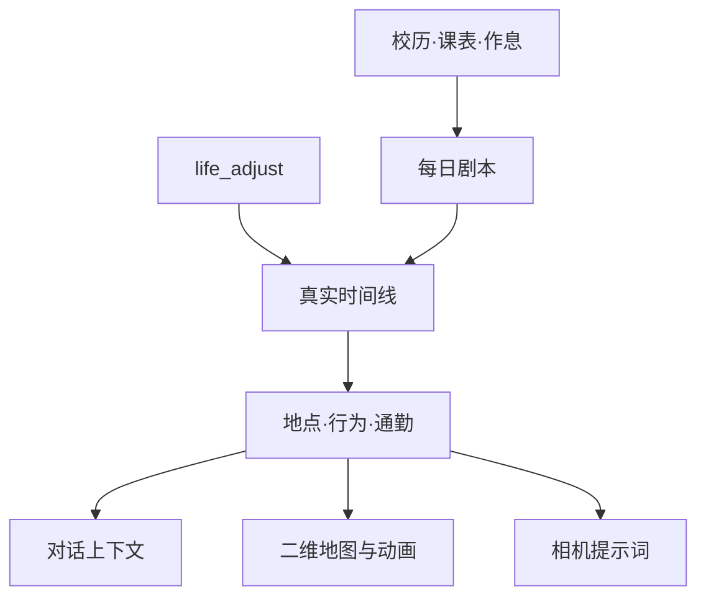

# dsh-feiyu-life · 鱼的生活

[](https://www.npmjs.com/package/dsh-feiyu-life)
[](https://github.com/Vansnc/dsh-feiyu-life/actions/workflows/ci.yml)
[](./LICENSE)
[](https://nodejs.org/)

让角色拥有一条独立于聊天、会随时间和地点自然推进的生活线。

它不只是回答“现在在干什么”：每天会形成稳定的剧本，临时改变会留下可撤销的调整；同一份世界状态同时驱动对话、二维地图、角色动作和相机，避免角色在聊天里位于图书馆、地图却停在宿舍。

## 现在能做什么

| 能力 | 表现 |
|---|---|
| 每日生活 | 根据校历、课表、作息和最近几天生成 00:00–24:00 剧本；模型失败自动退回本地模板 |
| 状态推进 | 计划随时间推进，`life_adjust` 可覆盖临时时段；重叠时以后写入的调整为准 |
| 二维地图 | 在宿舍、教学楼、图书馆、食堂等地点间生活；跨地点自动计算路线和通勤进度 |
| 行为动画 | 透明动作图集包含待机、走路、睡觉、学习、吃饭、玩手机、拍照七组四帧动画 |
| 同源相机 | `shoot` 拍照直接读取当前地点、穿着和行为，支持参考图、自检与失败重拍 |
| 可解释设置 | 时间线、状态来源、地图位置、调整历史和剧本历史都能在设置页查看 |
| 长期运行 | 配置迁移、硬超时、日志轮转、历史清理、照片额度和单任务锁均已内置 |

## 快速开始

运行要求：

- Node.js `>=22`；
- DSH `>=0.2.0-rc.1`；
- 只使用生活线和地图时不需要配置生图服务；启用相机时才需要方舟配置。ImageMagick 用于压缩大图，未安装时保留原始 PNG。

安装：

```bash
dsh plugin --profile web add dsh-feiyu-life
```

安装或更新后刷新浏览器，在 **设置 → 鱼的生活** 中完成校历、课表、作息和地图配置。

更新时建议先移除旧包，避免命中宿主缓存：

```bash
dsh plugin --profile web remove dsh-feiyu-life
dsh plugin --profile web add dsh-feiyu-life
```

## 角色会得到什么上下文

插件会把复杂状态压成几行上下文，不让角色照着时间表念：

```text
（今天）11月11日 周三·上课日。排队排到门口，最后没吃上。
（此刻）图书馆三层角落，摊开速写本勾海报草图，手机静音，身上是灰毛衣。
（早些时候）食堂排十分钟，端着麻辣烫绕两圈找座。
（接下来）16:30 去校门口文具店挑马克笔。
（说话）这些是你自己的日子，别当时间表念，不报时间段、不列清单。
```

状态机只约束角色如何理解自己的生活，不从聊天内容反推状态。真正改变计划时，由角色调用 `life_adjust` 写入明确的调整段。

## 一份状态，四种表现



状态只有两个写入来源：

1. **计划**：模型剧本或本地模板形成当天的基础时间线；
2. **调整**：`life_adjust` 对指定时段进行覆盖。

地图和相机都是消费者，不会各自维护另一套“此刻”。详细数据流和工程约束见 [整体设计](./docs/DESIGN.md)。

## 地图与行为动画

默认地图包含六类逻辑地点：宿舍、教学楼、图书馆、食堂、便利店/快递点、校外/街上。每个地点由坐标和关键词决定；相邻活动位于不同地点时，系统会在前一段末尾留出通勤时间，并沿最短路径插值角色坐标。

角色动画来自 `assets/character-actions.png`，是带透明通道的 4×7 动作图集：

| 行为 | 常见触发内容 | 动画 |
|---|---|---|
| 待机 | 无法归入其他行为 | 轻微表情变化 |
| 走路 | 出发、路上、公交、地铁、自动通勤 | 行走四帧 |
| 睡觉 | 睡着、午睡、眯一会儿 | 卧睡四帧 |
| 学习/创作 | 上课、自习、看书、作业、画画、剪片、修图 | 阅读四帧 |
| 吃东西 | 早餐、午饭、晚饭、食堂、外卖、奶茶 | 进食四帧 |
| 玩手机 | 刷手机、游戏、B 站、看剧 | 手机四帧 |
| 拍照 | 拍照、相机、自拍 | 相机四帧 |

洗漱等暂未配置独立图集的行为仍显示自己的状态气泡，但视觉上使用待机首行。开启系统“减少动态效果”后，动画停在对应行为的首帧，不会退回白底头像。

## 设置页

设置页共有八个页签：

| 页签 | 主要内容 |
|---|---|
| 此刻 | 今日时间线、当前命中段、注入文本、计算证据、调整历史、剧本重生成与撤销 |
| 地图 | 实时位置、行为和移动进度；地点坐标、关键词、路径耗时；地图与自动通勤开关 |
| 年度 | 学期、假期、考试周等特殊时段和节日 |
| 课表 | 周一至周日的课程时段和手机状态 |
| 作息 | 日常、晚起、假期、备考四张作息表 |
| 身体 | 经期参数和躺平、出门、翘课等偏离概率 |
| 事件 | 上午/中午/下午/晚上的小事件和可选触发条件 |
| 照片 | 模型、参考图、形象、画风、画幅、自检、额度、试拍和最近照片 |

编辑中的配置与已保存配置相互分离。保存时服务端会统一校验并显示修正项；重新读取会先确认是否丢弃未保存内容。

完整字段、取值范围和文件位置见 [配置参考](./docs/CONFIGURATION.md)。

## 每日剧本与临时调整

- 插件启动后会确保今天和明天都有剧本，此后约每 20 分钟补查一次；已经存在的日期不会重复生成；
- 剧本会参考日子类型、身体底色和最近三天，减少每天重复；
- 模型超时、输出不合法或睡眠不足六小时，会安全退回本地模板；
- 同一天剧本写入后保持稳定，重启不会改变；
- 手动重生成前自动保存快照，失败恢复旧剧本，成功后仍可撤销；
- `life_adjust` 调整可在「此刻」页逐条查看和删除。

## 相机

插件内置 `shoot` 工具：`selfie` 拍角色自己，`scene` 拍其他画面。

- 地点、穿着和行为直接读取同一份世界状态；
- 自拍可用参考图锁定角色，默认查找 `~/.dsh/feiyu-life-image/角色设定/正面.jpg`；
- 支持模型扩写提示词、本地模板、自检和最多两次配置范围内的重拍；
- 主生图模型失败后可切换备用模型；
- 对话拍照与设置页试拍共享每日额度、最短间隔和单任务锁；
- 模型、生图、下载和图片处理都有硬超时；
- 默认仅清理超过 90 天的插件照片，不删除角色参考图。

## 数据与隐私

生活配置、剧本、调整、照片和日志均保存在 `DSH_HOME`（未设置时为 `~/.dsh`）中。插件不会写入会话日志，也不会把子代理当作角色本体注入生活状态。

所有设置接口都经过宿主连接鉴权；请求体有大小限制。剧本和调整默认保留 180 天，照片默认保留 90 天，日志按 1 MiB 轮转并保留三份历史。

## 常见问题

### 设置页没有出现

先刷新浏览器。若使用本地目录安装，确认 `cordis.patch.yml` 的 `name` 指向该目录中 `index.js` 的绝对路径，然后移除并重新安装插件。

### 地图位置或动作不符合预期

地点和行为都由活动短句中的关键词推断。先在「地图」页补充更具体的地点关键词；动作映射属于代码规则，当前支持上表七组动画。修改地图后需要保存配置。

### 修改课表后今天没有变化

已生成的每日剧本会保持稳定。保存配置后，在「此刻」页点击“重新生成今日剧本”；若结果不满意，可以撤销上次重生成。

### 相机不能出图

生活线和地图不依赖生图服务。相机需要可用的方舟配置和模型权限；同时检查每日额度、最短间隔及设置页返回的错误信息。未安装 ImageMagick 只会跳过 JPEG 压缩，不应阻止原始 PNG 生成。

### 配置写坏了怎么办

优先通过设置页保存，服务端会校验时区、日期、时段、概率和地图边界。手动编辑后若字段无效，读取时会迁移或恢复为安全值；重要配置仍建议自行备份。

## 已知边界

- 插件描述角色“在做什么”，不会决定“要不要回复消息”；
- 聊天内容本身不会改变生活状态，计划变化必须经过 `life_adjust`；
- 地图是二维逻辑地图，不是自由寻路或 3D 建模系统；
- 当前动作图集有七组行为，洗漱等行为暂用待机视觉；
- 农历节日不会自动换算，需要按实际公历日期配置；
- 只向顶层角色会话注入状态，子代理不会继承本体生活线。

## 本地开发

```bash
git clone https://github.com/Vansnc/dsh-feiyu-life.git
cd dsh-feiyu-life
npm run check
npm test
npm pack --dry-run
dsh plugin --profile web add "$(pwd)"
```

本地挂载、动作图集约束和提交要求见 [参与贡献](./CONTRIBUTING.md)。问题和功能建议请使用仓库的 [Issue 模板](https://github.com/Vansnc/dsh-feiyu-life/issues/new/choose)。

## License

[MIT](./LICENSE)
