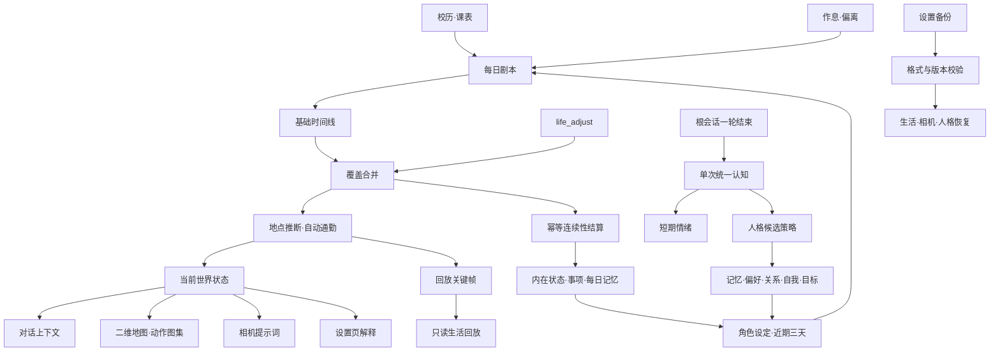

# 鱼的生活：整体设计

本文描述当前产品边界、状态流、空间层、动画契约和工程约束。它是实现说明，也是后续改动的判断基准；字段说明另见 [配置参考](./CONFIGURATION.md)。

## 1. 产品目标

角色应该拥有一条独立于聊天、但能被聊天感知的生活：时间会自然推进，主动改主意时留下明确调整；同一个“此刻”同时出现在对话、地图、动作和照片里。

核心原则：

1. **状态只有一个真相来源**：计划 + `life_adjust`，不从自然语言聊天反推；
2. **同一天稳定，跨时段变化**：每日剧本固定，只在时间段边界与“今天的小事”的阶段边界变化，不按小时重新抽卡；
3. **空间是时间线的投影**：地图只解释时间线，不创造另一套位置；
4. **表现层不能修改事实**：动画和相机消费 `world`，不能反向改行为；
5. **失败可降级，结果可解释**：模型失败退模板，设置页展示命中段和来源。
6. **计划不是完成**：连续性只从已经结束的最终真实时间线结算，覆盖掉的计划不产生效果。
7. **人格成长慢于一次对话**：模型只提出候选，确定性策略决定沉淀；新消息和明确指令永远高于旧记忆。
8. **主动不等于越权**：角色可以在根会话开口，但不能自主联系第三方、消费、发帖、操作任意文件或冒充现实执行。

## 2. 状态流

### 人格认知闭环

`reflection.js` 在根会话回复完成后异步执行一次模型调用，同时规范化情绪、记忆、偏好、目标、自我证据、关系感受和主动意图。它不保存输入/回复原文。`mind.js` 再以代码策略做最终决策：敏感内容不自动落库；用户偏好要求明确证据；目标必须明确且仅限虚拟/插件本地；自我特质需要三次独立同向证据；关系指标每轮只允许小幅变化。事件 ID 和已应用集合保证同一回合不会重复沉淀。

对话前，`mindContext()` 只按当前消息本地召回少量相关记忆，并与稳定自我、偏好、活跃目标和主观关系摘要一起压缩到字符上限。提示明确要求不得逐条复述、不得让旧记忆压过新消息、冲突时承认不确定。该层不读取任意用户文件，也不依赖向量数据库。

主动分享由插件内唯一一个 initiative 定时入口负责，不依赖外部主动搭话插件，也不另开定时器。每轮先构建“已发生事件”候选（小事阶段、已完成片段、首日身体变化、连续性后续），再经过睡眠/洗澡/上课/手机/会话忙/安静时段/刚聊过/每日额度/全局冷却/同类冷却/事件阶段去重/最低分，最后才通过 `agent.followup` 投递。Future plan rows are rejected at candidate construction. 手动检查只跳过检查间隔，不绕过安全闸门。

### 生活一致性

时间线是唯一的“正在发生”，但必须能被普通生活解释：

1. **作息先成一条完整日**。`normalizeRoutine()` 排序、裁重叠、补空档；缺失的开头补睡、缺失的结尾延续上一段。课表是覆盖层，冲突时先到者保留、后到者截断；临时出门只在课表之外找窗口。最终时间线保证 00:00–24:00 连续且任意时刻只命中一段。
2. **穿着跟着地点与动作走**，不靠单个关键词。`occasion()` 先看显式 `behavior/locationId`，再看文本；“一天没出门”“在宿舍躺着”会归到 home，不会给躺床的人套外衣。
3. **手机状态回答“能不能回”**。`replyReadiness()` 从睡眠、洗澡、通勤、静音和手机位置派生 `now / slow / later / asleep`；上下文只写简短结果，主动分享继续使用同一组状态做闸门。
4. **精力由真实夜晚推出**。`lastNightSleep()` 合并昨日夜间与今日午前的睡眠段，缺计划时退回作息表；`vitalityFor()` 由睡眠、经期、感冒、清醒时长和当前活动计算，再把连续性基线小幅混入，避免“四点睡却精力不错”。
5. **感冒是连续事件**。`coldEpisode()` 以日期种子启动一次 2–3 天的病程，不逐日独立抛硬币。
6. **今天的小事单独持久化并受整天约束**。`moments.js` 每天最多两件，阶段由时间推进，最近七天抑制重复；每个阶段带地点、是否已真实外出、是否在用餐窗口内等约束，当前地点/时间线对不上时整件不注入。文件只保存模板 id、开始分钟和已知人物名，不保存任意可注入的提示文本；没有天气数据时不生成天气细节。
7. **人格不写在生活层**。每日剧本提示词只读取可选的 `角色设定`；未配置时只写生活事实，不内置姓名或性格（人格由对话侧的人格层负责）。

### 主动分享

`sharing.js` 把候选、评分和账本拆开：

1. **只读已完成事实**：`life.timeline` 中 `end <= now` 的片段、`life.moment` 当前兼容阶段（stage ≥ 1 且地点/外出/用餐已验证）、首日感冒/经期和 120 分钟内的连续性变化；未来片段在构造时直接排除。
2. **评分**：新鲜度、活动类别、是否由 `life_adjust` 产生、是否与近期对话有关、是否为同一事件后续；不带戏剧化权重，普通课堂/吃饭通常低于最低分，出门和已调整事件才可能过线。
3. **去重与冷却**：`stageKey` 保证同一阶段只分享一次；`eventId` 串联同一件事的后续；同类冷却只拦不同事件的同类，后续不受同类冷却影响但要求至少 60 分钟间隔；全局冷却只拦新事件。
4. **投递语义**：`takeShare()` 在锁内写 pending 租约，`followup(message)` 当前是同步入队，没有“模型真的回复了”的回调；只有入队调用不抛错（或未来 Promise resolve）后 `commitShare()`，失败 `releaseShare()` 并记失败次数，最多两次。租约过期可被下一次检查回收；进程在投递后、提交前崩溃仍可能在租约过期后重试，这是已知限制。
5. **持久账本**：`feiyu-life-sharing.json` 保存每日额度、全局/同类冷却依据、最近分享、失败次数和 pending 租约；重启不会重复轰炸，过期租约会被回收。

### 内在驱动

`agency.js` 是一个**内部议程**，不是第二个发送器。它的内部 tick 与对外分享解耦：分享关闭时仍推进，但只写本地状态，不调用 `followup`。

1. **候选来源**：连续性里未完成的任务/约定/主线、自己的 `mind` 目标、低精力/压力/社交需要、自己的偏好、明确承诺、关系记录和近期已落盘事件。候选保留真实来源 ID、TTL、截止时间、下一步和成本，不复制事实。
2. **选择**：按紧迫度、来源类型、剩余进度、成本和一个 15 分钟的最小保持时间选一个焦点；高优先候选可以被推迟，必要时切换；反复被推迟的来源会进入 abandoned，只有来源更新才 reopen。焦点写入 `feiyu-life-agency.json`（v2），重启后继续。
3. **观察与完成**：只有连续性来源真的变成 completed/cancelled，或 mind 目标的进度发生变化，焦点才更新步骤；goal/thread 的内部执行器只执行一次“复盘”并写 `executions`，不自动完成现实任务，也不冒充用户确认。
4. **进入上下文**：`agencyContext()` 只加一句“心里在推进”，生成剧本时作为“她心里的事”的一个来源，聊天时也只作为底色。
5. **跟进候选**：`agencyShareCandidates()` 可以把快到期的任务/约定或自己的下一步变成 `followup` 候选；这不是“已经发生的生活分享”，提示词明确要求不能声称完成、不能催。outreach 状态记录等待/回应/忽略/拒绝，跨日和忽略后降频；来源产生新事实才恢复。

日常剧本的模型提示词还会收到：衣柜六类、当前心情底色、自己的目标/偏好和内在议程焦点。模型写出的 `outfit` 会在服务端按场景校验，衣柜外的衣服回落到对应类别，避免衣柜只停留在设置页。

### 存储与并发

配置、剧本、调整和今天的小事都走 `storage.js`：唯一临时文件 + rename 原子替换；读取先检查大小上限；损坏的配置文件移到 `.corrupt-*` 后重建。调整记录按天最多 64 条，重生成快照每天最多 10 份，今天的小事文件不超过 64 KiB，旧文件按保留期清理。跨进程的调整和配置读写使用短期文件锁，锁过期可回收，崩溃不会留下永久锁。

### 计算层级

| 层级 | 输入 | 输出 | 稳定窗口 |
|---|---|---|---|
| 年 | 学期、假期、特殊周、节日 | 作息表与是否上课 | 日期范围 |
| 周 | 星期与课表 | 当天课程段 | 一周 |
| 日 | 日子类型、偏离概率、模型剧本 | 00:00–24:00 基础时间线 | 一天 |
| 刻 | 时钟、调整、身体、情绪、内在焦点、小事的阶段 | 此刻、刚才、零碎、接下来 | 时间段边界 / 小事阶段 |
| 空间 | 当前与相邻时间段、地点图 | 位置、行为、路线和移动进度 | 当前段 |

## 3. 时间线与调整

基础时间线来自模型剧本；若模型超时、结构不合法或睡眠不足六小时，则使用本地模板。生成成功后按日期落盘，同一天不会因重启或再次询问而变化。

剧本写入时记录 `scheduleRevision`（作息、课表、校历、节日、偏离、经期等日程字段的稳定指纹）。白天修改这些设置后，下一次注入会调用 `mergeFutureItems()`：已经开始的片段原样冻结，只从当前片段结束处重建未来；未来片段优先复用原剧本中同类活动的细节和 `links`（只有完整保留时才保留关联，避免重复结算）。合并结果只在内存中生成，不覆盖磁盘上的基础剧本，因此连续改多次不会层层叠加，也不会触发模型调用。旧剧本没有指纹时会保守合并，过去部分同样不动。

`life_adjust` 是唯一显式改计划入口。调整段覆盖基础段并切开前后边界；多条调整重叠时，后写入者优先。损坏、负时长或无法解析的段不得进入真实时间线。

### 连续性结算

长期主线、短期待办和约定都拥有稳定 ID、来源、创建时间和状态。模型只能关联当次提示中列出的活动 ID，不能新造实体；取快递等一次性行为必须归入短期待办。`state.js` 会给被 `life_adjust` 切开的计划残段留下 `overridden` 标记，任何带该标记的关联都不结算；系统为真实通勤预留的末尾分钟不冒充用户调整，不会误伤已经实际完成的关联活动。

内在状态和事项变化使用由日期、真实段边界、来源及关联 ID 派生的 effect ID。已应用 ID 与连续性状态在同一次原子文件替换中落盘，重复启动或重复手动结算不会累计两次。独立按日账本用于审计，每项变化保留原因与 `timeline:<date>` 来源。

数值状态只用于计算，不直接塞给人格。`continuityContext()` 将其翻译为精力、压力、社交倾向和睡眠感受，并结合按截止时间排序的事项与最近生活记忆压缩为少量自然语言。上下文明确禁止逐条播报，只允许在话题相关时自然想起。

### 人物关系与共同记忆

人物是用户显式维护的白名单，不从普通聊天、通讯录或模型输出中自动提取。每个人拥有稳定 ID、来源、关系说明、备注、亲近感、互动次数和上次互动时间。姓名、关系和备注等计划相关字段进入 `continuityRevision`，所以新增或修改人物后，预生成的明日剧本会显示为待同步，不会在后台自动增加模型调用；互动计数本身不会造成无意义的反复过期。

模型只能在剧本段的 `people` 中引用白名单 ID，并用 `warm`、`neutral`、`tense` 描述相处底色。服务端再次过滤未知 ID。结算仍以最终真实时间线为准：完整发生的互动才更新关系、社交需要和共同记忆；被 `life_adjust` 切开的段完全不算。每个“日期 + 时间段 + 人物”生成稳定 effect ID，因此重跑不会重复改变关系。绑定 `personId` 的约定兑现时，会隐式形成一次普通互动，避免模型漏写重复字段。

睡眠欠账采用日级效果：当天最终时间线结束后汇总睡眠段，与 480 分钟目标求差，并使用 `date|daily|sleep-balance` 派生的 effect ID 保证一天只结算一次。普通睡眠段只恢复精力、缓解压力，不再重复扣减欠账。

预生成剧本保存 `continuityRevision`。该修订由所有活跃实体的计划相关字段稳定哈希得到；修改事项后只标记明日剧本过期，不自动调用模型。用户显式同步时先归档明日剧本，再生成新版本；失败恢复归档，确保成本可控和版本可回退。

成果执行仅是现实动作的安全替代记录：`document` 追加已完成活动、时长和进展，覆盖前保存历史版本；`album` 只维护“待从已有照片中人工选择”的清单。输出目录由主线 ID 哈希派生且位于插件目录，不允许调用外部服务、自主生图或接受任意文件路径。

手动重生成今日剧本前必须保存快照：失败恢复原文件，成功后也允许用户撤销。调整记录同样必须可见、可删除。

## 4. 空间层与自动通勤

`world.js` 对每个真实时间段做两件事：

1. 优先读取剧本或调整显式写入的 `locationId` 和 `behavior`，旧数据缺字段时才根据活动短句与地点关键词推断；
2. 当相邻连续时段位于不同地点时，在前一段末尾插入确定性的 `travel` 段。

路径图按双向加权边处理，以分钟为权重寻找最短路线。默认边的几何由构建脚本从 OSM 最大连通步行道路图计算，经折线简化后写入 `xueyuan-world.js`，不手工猜测转弯。移动中根据每条边耗时分配进度，并按每个 `via` 线段的几何长度插值；路径不可达时使用有限的直连兜底。自动通勤生成的段必须同时进入时间线、对话世界状态、地图和相机，不能只做前端动画。

没有地点词的承接段沿用上一段地点，避免「接着整理笔记」跳回默认宿舍。行为兜底只匹配明确短语，并排除否定与旁观语境；表现层不得通过扩大模糊单字规则修补个例。设置页提供与运行时同源的识别测试接口。

关闭自动通勤只停止插段，不停止地点推断；关闭地图后空间表现可隐藏，但基础时间线和调整仍继续工作。

地图视觉层以配置中的地点坐标和路径为唯一几何来源。草地、水域等景观仅提供氛围，不参与寻路；地标不能用写死坐标替代配置。移动状态通过 `world.route` 高亮实际经过的道路，角色位置仍由同一组路径分段插值，保证路线、时间线和角色位置一致。

学院路模式按三层渲染：`xueyuan-base.svg` 保存 OSM 的道路与校区几何，`xueyuan-anime.svg` 负责日系配色、绿地和水域，`xueyuan-buildings.svg` 只放无文字的建筑轮廓；运行时顶层用透明背景 SVG 图标和名称表达 POI，再叠加逻辑路径与角色。底图不得重复绘制地点或道路名称，以免与交互标记重叠。三张 SVG 与 `xueyuan-world.js` 共用 `0 0 1000 560` 视图，不能分别拉伸或裁切。地图数据的范围、处理方式与 ODbL 署名记录在 `assets/maps/ATTRIBUTION.md`。

## 5. 行为动画契约

地图角色运行时使用 `assets/actions/<behavior>.png`。每个动作是 512×128、4 列 × 1 行的独立透明动作条，每帧 128×128；完整的 `assets/character-actions.png` 仅为旧客户端保留。

| 文件 | `world.behavior` | 内容 |
|---|---|---|
| `idle.png` | `idle` | 待机 |
| `walk.png` | `walk` | 走路 |
| `sleep.png` | `sleep` | 睡觉 |
| `study.png` | `study` | 学习/创作 |
| `eat.png` | `eat` | 吃东西 |
| `phone.png` | `phone` | 玩手机 |
| `photo.png` | `photo` | 拍照 |
| `bath.png` | `bath` | 洗漱/刷牙 |

`client.js` 按行为加载独立动作条并只在水平方向播放四帧，不能从完整纵向图集中偏移裁行，也不能用白底裁图、整图旋转或上下晃动代替动作。每个行为都必须有同名资源，不能静默借用 `idle` 掩盖缺图。

系统启用 `prefers-reduced-motion` 时应停在当前行为首帧，并禁用位置过渡；不能回退到另一张头像。

更换图集时必须保持：

- 每个动作条保持 4×1 等分网格；
- 每帧角色比例、中心和脚底基线尽量一致；
- 透明背景，不带文字、网格、白底或外框；
- 道具只能出现在对应动作中；
- 安装包中仍包含该资源，接口返回 `image/png`。

## 6. 模块职责

| 模块 | 负责 | 不负责 |
|---|---|---|
| `life.js` | 配置边界、校历、偏离、上下文压缩、组装当前状态 | 文件路由、模型调用 |
| `plan.js` | 模板时间线、日子类型、剧本落盘与历史 | 对话注入 |
| `state.js` | 计划和调整的覆盖合并、时间点查询 | 生成新计划 |
| `continuity.js` | 连续性实体、人物关系、内在状态、幂等结算、每日记忆和安全本地成果 | 外部现实动作、任意文件操作或生图 |
| `reflection.js` | 回合反思、短期情绪回稳、统一事件账本、额度与隐私裁剪 | 保存对话原文、直接写长期记忆或阻塞正常回复 |
| `mind.js` | 人格状态、候选策略、本地召回、显式编辑、旧主动配置兼容读取与外部插件检测 | 外部现实动作、凭据存储或替外部插件维护数据 |
| `world.js` | 地点推断、路径、通勤、行为和坐标 | 生成日程、渲染 UI |
| `gen.js` | 调模型写每日剧本、规范化模型输出 | 修改真实状态 |
| `index.js` | 生命周期、工具、鉴权接口、定时生成与维护 | 复制状态计算规则 |
| `image-prompt.js` | 把同源世界状态翻译成画面提示词 | 自行推断另一套“此刻” |
| `image.js` | 生图、自检、重拍、额度、存储与图片接口 | 角色生活状态 |
| `backup.js` | 版本化设置备份的创建、校验与规范化 | 读写照片、剧本或宿主凭据 |
| `runtime.js` | 超时信号与轮转日志等运行时基础设施 | 业务状态 |
| `client.js` | 编辑、解释、地图表现、预览和试拍 | 在浏览器重算业务规则 |

## 7. 设置页信息架构

页面先展示总览，再进入十三个页签：

1. **此刻**：真实时间线、当前段、注入文本、证据、剧本和调整历史；
2. **分享**：主动分享开关、额度、冷却、安静时段、最低分和手动检查；
3. **人格**：自我、长期记忆、偏好、关系感受、自身目标与插件兼容；
4. **内在**：短期情绪、变化原因、反思用量、成本设置与统一事件账本；
5. **连续性**：内在需要、三类事项、人物关系、来源、每日记忆、结算策略和安全边界；
6. **回放**：服务端按时间线生成关键帧，按日期只读播放地点、通勤和行为；
7. **地图**：实时位置、移动进度、行为动画、地点与路径；
8. **年度**：维护学期、假期、特殊周与节日；
9. **课表**：维护一周七天的课程覆盖；
10. **作息**：维护日常、晚起、假期与备考的生活骨架，以及每日剧本用的「角色设定与衣柜」；角色设定留空时生活层不添加人格文案；
11. **身体**：配置经期与偏离概率；当天生活细节由模型剧本统一生成，不再维护平行事件池；
12. **照片**：消费世界状态，不创造新状态；
13. **数据**：将生活、相机与人格作为一个版本化备份导出，并安全恢复。

交互约束：

- 编辑草稿与已保存配置分开；未保存时持续提示；
- 重新读取前确认是否丢弃草稿；
- 服务端统一规范化配置，修正项必须反馈给界面；
- 每日剧本默认稳定：白天修改日程只增量对齐尚未发生的片段，已发生的片段冻结；只有用户明确操作才整体重写；
- 作息骨架与课表作为模型剧本的上游约束；模型剧本生成后，`life_adjust` 或安全的前景日程补丁可以改变未来，过去只读；
- 昂贵操作（重写剧本、试拍）显示结果和失败原因。

## 8. 数据与持久化

| 数据 | 路径（相对 `DSH_HOME`） | 写入策略 |
|---|---|---|
| 生活配置 | `feiyu-life-config.json` | 版本迁移、校验后原子替换 |
| 每日剧本 | `feiyu-life-days/<date>.json` | 一天一次，原子替换；默认保留 180 天 |
| 重生成快照 | `feiyu-life-days/history/<date>/` | 替换前复制；撤销后消费 |
| 临时调整 | `feiyu-life-facts/<date>.json` | 同起点覆盖，原子替换；默认保留 180 天 |
| 连续性状态 | `feiyu-life-continuity.json` | 原子替换并保留 `.bak` 恢复副本 |
| 短期内在状态 | `feiyu-life-affect.json` | 衰减后读取、事件 ID 幂等应用、原子替换并保留 `.bak` |
| 人格大脑 | `feiyu-life-mind.json` | 原子替换并保留 `.bak`；永久删除后以清理后的状态覆盖恢复副本 |
| 统一事件账本 | `feiyu-life-events/<date>.json` | 按日有界保存反思与真实生活结算，不保存对话原文 |
| 结算账本与记忆 | `feiyu-life-effects/`、`feiyu-life-memories/` | 按日原子替换，effect ID 幂等 |
| 安全本地成果 | `feiyu-life-projects/<hashed-id>/` | 限额更新；文档覆盖前留历史，清单条目带 effect ID |
| 相机配置 | `feiyu-life-image-config.json` | 独立版本迁移、原子替换 |
| 图片 | `feiyu-life-image/` | 插件照片默认保留 90 天，参考图不清理 |
| 日志 | `feiyu-life*.log` | 1 MiB 轮转，保留三份历史 |

设置备份是显式下载的便携 JSON，v2 包含生活配置、相机配置与人格大脑。宿主凭据、每日剧本、连续性历史、事件账本、临时调整、照片与日志不属于备份范围。恢复前必须完整校验三份数据；写入任一失败时回滚到恢复前状态。v1 旧备份不含人格，恢复时不得清空当前人格。

配置文件的中文键属于用户契约；运行时段统一使用 `start / end / what / phone / outfit / source`。新增配置字段必须向后兼容，未知字段不应无故丢失。

## 9. 可靠性与安全边界

- 所有设置接口都经过宿主连接鉴权，鉴权失败应拒绝访问；
- 请求体有大小上限，模型输出必须经过规范化；
- 模型流、网络生图、下载和外部图片处理都有硬超时；
- 超时不能继续等待供应商流的关闭动作；
- 可选的 ImageMagick 压缩使用异步子进程并限制执行时间，失败时保留原始 PNG，不能阻塞宿主事件循环；
- 对话拍照和设置页试拍共享每日额度、冷却与单任务锁；
- 清理任务只删除严格匹配插件命名的过期文件；
- 只向顶层角色会话注入状态，子代理不继承本体生活线。
- 回合反思在回复完成后异步执行且每轮最多一次；失败只能降级并留审计，不能挡住回复；
- 一次反思同时产出情绪与候选，禁止为心情、记忆、关系分别重复调用模型；
- 只有显著偏离基线的短期情绪进入上下文，且必须随时间回稳；人格候选只有通过确定性门槛才可落库；
- 自动候选与事件账本必须拦截凭据、证件和银行卡等敏感文本；永久删除不得把内容留在自动恢复副本；
- 主动分享默认低打扰，必须经过全部安全闸门；投递以 `followup` 入队接受为已投递（当前接口没有模型回复回调），手动检查不得谎报已经发送；
- 外部记忆和心情插件可共存；外部优先时只抑制对应的内建心情/记忆，不复制其代码或改写其数据。主动分享不接入外部主动插件。

照片历史不得直接批量加载生图原件。设置页首屏只渲染有限数量的图片，并通过 `/image/file?thumb=1` 请求服务端缓存的 480px JPEG 缩略图；只有用户打开灯箱时才请求原图。缩略图与原图使用相同时间戳命名，参与保留期清理，自检重拍时也要一起改名，不能留下失去来源的缓存文件。

生图质量链路优先保留模型原生细节：Seedream 5.x 使用标准提示词优化和无损 PNG，默认按 2K 画幅生成；对话发送用副本只缩到 2048px、JPEG q93、4:4:4 采样，设置页灯箱仍读取完整原图。人物侧唯一输入是参考图；配置为空时，高清正面图与三视图直接作为多图条件，不经过中间重绘。正面图承担脸部身份和主要画风，三视图补充体型、鲸类耳鳍、鲸尾与侧背结构。生活层注入地点、动作、时间与实际穿着；扩写层每张重新决定可变发型、表情、抓拍时机、镜头、光色、景深和环境细节，最终提示词上限为 900 字。身份连续性与可变外貌必须分离：脸、五官比例、瞳色、基础发色、鲸类辨识特征和插画语言稳定，发型扎法、碎发、湿润、整齐度、疲态和妆容可以随生活变化。场景照也发送参考图，但提示词和质检都要求只继承画风、不得混入人物。模型扩写失败时，动态本地兜底使用当次随机种子，不能恢复固定外观模板。

角色参考输入是一个有序参考库：配置可指向文件、目录或多个路径，运行时最多读取 10 张并优先正面、设定图、侧面和背面。照片生成成功后写入同时间戳 JSON 旁车文件，内容来自本次生图已经消费的 `world`/时间线状态。相册可以展示旁车数据，但不得从照片元数据反向覆盖计划、调整或世界状态。

生活回放通过 `/replay` 按需生成，不进入每 30 秒状态轮询。普通活动只输出状态切换关键帧，通勤段按最多两分钟间隔采样路线位置；客户端根据分钟选择最近的服务端帧，不复制路线插值、地点推断或行为识别。回放属于只读表现层，拖动和播放不得写入计划、调整或配置。

## 10. 必须长期保持的约束

- 时间线覆盖整天、顺序稳定、不得存在负时长；`24:00` 仅作为结束边界；
- 调整覆盖计划，同一时刻只能命中一个真实状态；
- 地图、对话和相机必须消费同一个 `world`；
- 动画只能表现行为，不能修改行为；
- 回放只能消费服务端关键帧，不能在浏览器重算生活事实；
- 生图提示词只能消费 `generate()` 返回的状态；
- 保存边界统一校验，配置迁移可重复执行；
- 所有降级都应给出可解释结果，而不是静默制造另一套状态。

## 11. 后续路线

1. 配置迁移记录可视化；
2. 重叠课表和作息空洞诊断；
3. 为购物、户外等行为补充独立透明序列帧；
4. 将地图从节点图升级为可选场景图层，同时保持 `world` 接口稳定；
5. 端到端宿主测试，覆盖鉴权、热更新、模型失败、图片重拍和动画资源加载。
