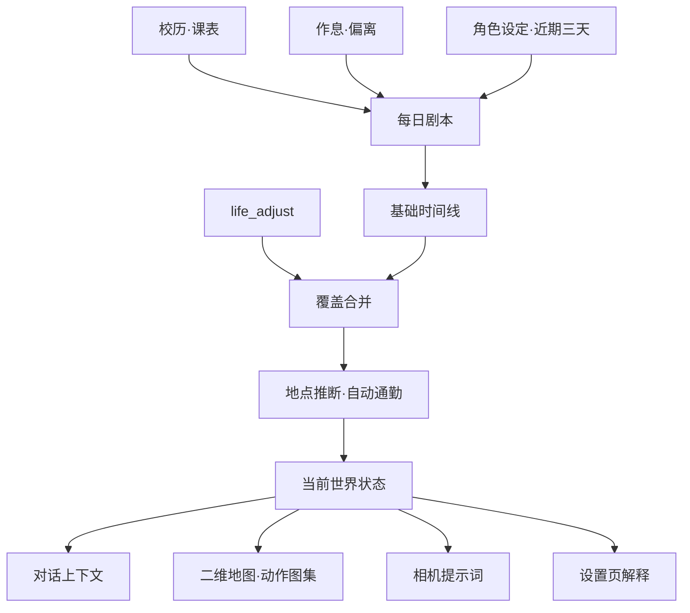

# 鱼的生活：整体设计

本文描述当前产品边界、状态流、空间层、动画契约和工程约束。它是实现说明，也是后续改动的判断基准；字段说明另见 [配置参考](./CONFIGURATION.md)。

## 1. 产品目标

角色应该拥有一条独立于聊天、但能被聊天感知的生活：时间会自然推进，主动改主意时留下明确调整；同一个“此刻”同时出现在对话、地图、动作和照片里。

核心原则：

1. **状态只有一个真相来源**：计划 + `life_adjust`，不从自然语言聊天反推；
2. **同一天稳定，跨时段变化**：每日剧本固定，小时与十分钟细节可重复计算；
3. **空间是时间线的投影**：地图只解释时间线，不创造另一套位置；
4. **表现层不能修改事实**：动画和相机消费 `world`，不能反向改行为；
5. **失败可降级，结果可解释**：模型失败退模板，设置页展示命中段和来源。

## 2. 状态流

### 计算层级

| 层级 | 输入 | 输出 | 稳定窗口 |
|---|---|---|---|
| 年 | 学期、假期、特殊周、节日 | 作息表与是否上课 | 日期范围 |
| 周 | 星期与课表 | 当天课程段 | 一周 |
| 日 | 日子类型、偏离概率、模型剧本 | 00:00–24:00 基础时间线 | 一天 |
| 刻 | 时钟、调整、身体与小动作 | 此刻、早些时候、接下来 | 小时/十分钟 |
| 空间 | 当前与相邻时间段、地点图 | 位置、行为、路线和移动进度 | 当前段 |

## 3. 时间线与调整

基础时间线来自模型剧本；若模型超时、结构不合法或睡眠不足六小时，则使用本地模板。生成成功后按日期落盘，同一天不会因重启或再次询问而变化。

`life_adjust` 是唯一显式改计划入口。调整段覆盖基础段并切开前后边界；多条调整重叠时，后写入者优先。损坏、负时长或无法解析的段不得进入真实时间线。

手动重生成今日剧本前必须保存快照：失败恢复原文件，成功后也允许用户撤销。调整记录同样必须可见、可删除。

## 4. 空间层与自动通勤

`world.js` 对每个真实时间段做两件事：

1. 优先读取剧本或调整显式写入的 `locationId` 和 `behavior`，旧数据缺字段时才根据活动短句与地点关键词推断；
2. 当相邻连续时段位于不同地点时，在前一段末尾插入确定性的 `travel` 段。

路径图按双向加权边处理，以分钟为权重寻找最短路线。默认边的几何由构建脚本从 OSM 最大连通步行道路图计算，经折线简化后写入 `xueyuan-world.js`，不手工猜测转弯。移动中根据每条边耗时分配进度，并按每个 `via` 线段的几何长度插值；路径不可达时使用有限的直连兜底。自动通勤生成的段必须同时进入时间线、对话世界状态、地图和相机，不能只做前端动画。

没有地点词的承接段沿用上一段地点，避免「接着整理笔记」跳回默认宿舍。行为兜底只匹配明确短语，并排除否定与旁观语境；表现层不得通过扩大模糊单字规则修补个例。设置页提供与运行时同源的识别测试接口。

关闭自动通勤只停止插段，不停止地点推断；关闭地图后空间表现可隐藏，但基础时间线和调整仍继续工作。

地图视觉层以配置中的地点坐标和路径为唯一几何来源。草地、水域等景观仅提供氛围，不参与寻路；地标不能用写死坐标替代配置。移动状态通过 `world.route` 高亮实际经过的道路，角色位置仍由同一组路径分段插值，保证路线、时间线和角色位置一致。

学院路模式按三层渲染：`xueyuan-base.svg` 保存 OSM 的道路与校区几何，`xueyuan-anime.svg` 负责日系配色、绿地和水域，`xueyuan-buildings.svg` 只放无文字的建筑轮廓；运行时顶层用透明背景 SVG 图标和名称表达 POI，再叠加逻辑路径与角色。底图不得重复绘制地点或道路名称，以免与交互标记重叠。三张 SVG 与 `xueyuan-world.js` 共用 `0 0 1000 560` 视图，不能分别拉伸或裁切。地图数据的范围、处理方式与 ODbL 署名记录在 `assets/maps/ATTRIBUTION.md`。

## 5. 行为动画契约

地图角色运行时使用 `assets/actions/<behavior>.png`。每个动作是 512×128、4 列 × 1 行的独立透明动作条，每帧 128×128；完整的 `assets/character-actions.png` 仅为旧客户端保留。

| 文件 | `world.behavior` | 内容 |
|---|---|---|
| `idle.png` | `idle` | 待机 |
| `walk.png` | `walk` | 走路 |
| `sleep.png` | `sleep` | 睡觉 |
| `study.png` | `study` | 学习/创作 |
| `eat.png` | `eat` | 吃东西 |
| `phone.png` | `phone` | 玩手机 |
| `photo.png` | `photo` | 拍照 |
| `bath.png` | `bath` | 洗漱/刷牙 |

`client.js` 按行为加载独立动作条并只在水平方向播放四帧，不能从完整纵向图集中偏移裁行，也不能用白底裁图、整图旋转或上下晃动代替动作。每个行为都必须有同名资源，不能静默借用 `idle` 掩盖缺图。

系统启用 `prefers-reduced-motion` 时应停在当前行为首帧，并禁用位置过渡；不能回退到另一张头像。

更换图集时必须保持：

- 每个动作条保持 4×1 等分网格；
- 每帧角色比例、中心和脚底基线尽量一致；
- 透明背景，不带文字、网格、白底或外框；
- 道具只能出现在对应动作中；
- 安装包中仍包含该资源，接口返回 `image/png`。

## 6. 模块职责

| 模块 | 负责 | 不负责 |
|---|---|---|
| `life.js` | 配置边界、校历、偏离、上下文压缩、组装当前状态 | 文件路由、模型调用 |
| `plan.js` | 模板时间线、日子类型、剧本落盘与历史 | 对话注入 |
| `state.js` | 计划和调整的覆盖合并、时间点查询 | 生成新计划 |
| `world.js` | 地点推断、路径、通勤、行为和坐标 | 生成日程、渲染 UI |
| `gen.js` | 调模型写每日剧本、规范化模型输出 | 修改真实状态 |
| `index.js` | 生命周期、工具、鉴权接口、定时生成与维护 | 复制状态计算规则 |
| `image-prompt.js` | 把同源世界状态翻译成画面提示词 | 自行推断另一套“此刻” |
| `image.js` | 生图、自检、重拍、额度、存储与图片接口 | 角色生活状态 |
| `runtime.js` | 超时信号与轮转日志等运行时基础设施 | 业务状态 |
| `client.js` | 编辑、解释、地图表现、预览和试拍 | 在浏览器重算业务规则 |

## 7. 设置页信息架构

页面先展示总览，再进入七个页签：

1. **此刻**：真实时间线、当前段、注入文本、证据、剧本和调整历史；
2. **地图**：实时位置、移动进度、行为动画、地点与路径；
3. **年度/课表/作息**：从低频到高频配置生活骨架；
4. **身体**：配置经期与偏离概率；当天生活细节由模型剧本统一生成，不再维护平行事件池；
5. **照片**：消费世界状态，不创造新状态。

交互约束：

- 编辑草稿与已保存配置分开；未保存时持续提示；
- 重新读取前确认是否丢弃草稿；
- 服务端统一规范化配置，修正项必须反馈给界面；
- 每日剧本默认稳定，只有用户明确操作才重写；
- 作息骨架与课表作为模型剧本的上游约束；模型剧本生成后，只有 `life_adjust` 可以改变当天事实；
- 昂贵操作（重写剧本、试拍）显示结果和失败原因。

## 8. 数据与持久化

| 数据 | 路径（相对 `DSH_HOME`） | 写入策略 |
|---|---|---|
| 生活配置 | `feiyu-life-config.json` | 版本迁移、校验后原子替换 |
| 每日剧本 | `feiyu-life-days/<date>.json` | 一天一次，原子替换；默认保留 180 天 |
| 重生成快照 | `feiyu-life-days/history/<date>/` | 替换前复制；撤销后消费 |
| 临时调整 | `feiyu-life-facts/<date>.json` | 同起点覆盖，原子替换；默认保留 180 天 |
| 相机配置 | `feiyu-life-image-config.json` | 独立版本迁移、原子替换 |
| 图片 | `feiyu-life-image/` | 插件照片默认保留 90 天，参考图不清理 |
| 日志 | `feiyu-life*.log` | 1 MiB 轮转，保留三份历史 |

配置文件的中文键属于用户契约；运行时段统一使用 `start / end / what / phone / outfit / source`。新增配置字段必须向后兼容，未知字段不应无故丢失。

## 9. 可靠性与安全边界

- 所有设置接口都经过宿主连接鉴权，鉴权失败应拒绝访问；
- 请求体有大小上限，模型输出必须经过规范化；
- 模型流、网络生图、下载和外部图片处理都有硬超时；
- 超时不能继续等待供应商流的关闭动作；
- 可选的 ImageMagick 压缩使用异步子进程并限制执行时间，失败时保留原始 PNG，不能阻塞宿主事件循环；
- 对话拍照和设置页试拍共享每日额度、冷却与单任务锁；
- 清理任务只删除严格匹配插件命名的过期文件；
- 只向顶层角色会话注入状态，子代理不继承本体生活线。

照片历史不得直接批量加载生图原件。设置页首屏只渲染有限数量的图片，并通过 `/image/file?thumb=1` 请求服务端缓存的 480px JPEG 缩略图；只有用户打开灯箱时才请求原图。缩略图与原图使用相同时间戳命名，参与保留期清理，自检重拍时也要一起改名，不能留下失去来源的缓存文件。

## 10. 必须长期保持的约束

- 时间线覆盖整天、顺序稳定、不得存在负时长；`24:00` 仅作为结束边界；
- 调整覆盖计划，同一时刻只能命中一个真实状态；
- 地图、对话和相机必须消费同一个 `world`；
- 动画只能表现行为，不能修改行为；
- 生图提示词只能消费 `generate()` 返回的状态；
- 保存边界统一校验，配置迁移可重复执行；
- 所有降级都应给出可解释结果，而不是静默制造另一套状态。

## 11. 后续路线

1. 配置导入、导出与迁移记录可视化；
2. 重叠课表和作息空洞诊断；
3. 为购物、户外等行为补充独立透明序列帧；
4. 将地图从节点图升级为可选场景图层，同时保持 `world` 接口稳定；
5. 端到端宿主测试，覆盖鉴权、热更新、模型失败、图片重拍和动画资源加载。
