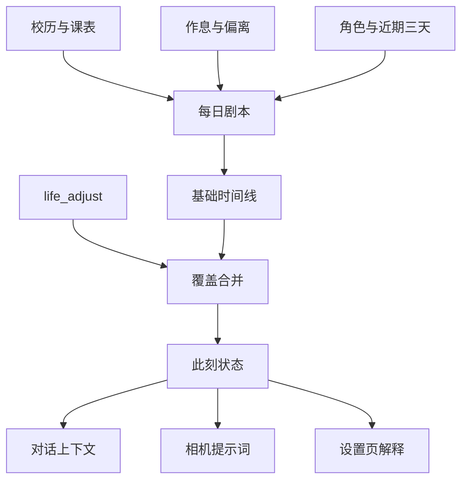

# 鱼的生活：整体设计

这份文档描述插件的产品边界、状态流、界面结构和工程约束。它既是当前实现的说明，也是后续改动时的判断基准。

## 1. 产品目标

让角色拥有一条独立于聊天、但能被聊天感知的生活时间线：时间自然推进，主动改主意时留下明确调整，拍照与说话永远读取同一份「此刻」。

三个核心原则：

1. **状态有唯一来源**：计划 + `life_adjust`，不从自然语言对话反推。
2. **同一天稳定、跨时段变化**：每日剧本固定；小时和十分钟级细节可重复计算。
3. **失败可降级、结果可解释**：模型失败退回本地模板；设置页展示日子类型、作息来源、剧本来源和命中段。

## 2. 状态流

### 计算层级

| 层级 | 输入 | 输出 | 稳定窗口 |
|---|---|---|---|
| 年 | 学期、假期、特殊周、节日 | 作息表与是否上课 | 日期范围 |
| 周 | 星期与课表 | 当天课程段 | 一周 |
| 日 | 日子类型、偏离概率、模型剧本 | 00:00–24:00 基础时间线 | 一天 |
| 刻 | 时钟、调整、身体与小动作 | 此刻、早些时候、接下来 | 小时 / 十分钟 |

## 3. 模块职责

| 模块 | 只负责什么 | 不应该负责什么 |
|---|---|---|
| `life.js` | 配置边界、校历、偏离、上下文压缩 | 文件路由、模型调用 |
| `plan.js` | 模板时间线、日子类型、剧本落盘 | 对话注入 |
| `state.js` | 计划与调整的覆盖合并、时间点查询 | 生成新计划 |
| `gen.js` | 调模型写每日剧本、规范化模型输出 | 修改真实状态 |
| `index.js` | 生命周期、工具、接口、定时生成 | 复制状态计算规则 |
| `image-prompt.js` | 把同源生活状态翻译成画面提示词 | 另算一套「此刻」 |
| `image.js` | 生图、检查、重拍、图片存储与接口 | 角色生活状态 |
| `client.js` | 编辑、解释、预览和试拍 | 在浏览器里重写业务规则 |

## 4. 设置页信息架构

页面先展示总览，再进入编辑：

1. **总览**：此刻、日子类型、作息来源、剧本来源；
2. **此刻**：真实时间线、注入文本、计算证据、时间旅行预览；
3. **年度 / 课表 / 作息**：从低频到高频配置生活骨架；
4. **身体 / 事件**：增加不完全可预测的人味；
5. **照片**：消费生活状态，不创造另一份状态。

交互约束：

- 本地编辑与已保存配置分开，未保存时持续提示；
- 重新读取会确认是否丢弃编辑；
- 保存由服务端统一规范化，修正项必须反馈给用户；
- 每日剧本默认稳定，只有用户明确点击「重新生成今日剧本」才替换；
- 危险或昂贵操作（重写剧本、试拍）要说明结果与成本。

## 5. 数据与持久化

| 数据 | 路径 | 写入策略 |
|---|---|---|
| 生活配置 | `~/.dsh/feiyu-life-config.json` | 校验后原子替换 |
| 每日剧本 | `~/.dsh/feiyu-life-days/<date>.json` | 一天一次，原子替换 |
| 临时调整 | `~/.dsh/feiyu-life-facts/<date>.json` | 同起点覆盖，原子替换 |
| 相机配置 | `~/.dsh/feiyu-life-image-config.json` | 校验后原子替换 |
| 图片 | `~/.dsh/feiyu-life-image/` | 新文件；废片改名保留 |

配置文件的中文键是用户契约；运行时段对象统一使用 `start / end / what / phone / outfit / source`。

## 6. 必须长期保持的约束

- 时间行覆盖整天、顺序稳定、不得存在负时长；`24:00` 只允许作为结束边界。
- 调整段覆盖计划段，不能出现同一时刻命中两个真实状态。
- 所有设置接口必须通过宿主连接鉴权；请求体有限额。
- 模型输出不可信，必须经过规范化；不足 6 小时睡眠的剧本退回模板。
- 生图提示词只能消费 `generate()` 返回的状态，禁止直接读剧本后自行推断。
- 配置新增字段时要向后兼容，未知字段不应无故丢失。

## 7. 后续路线

优先级从高到低：

1. 剧本历史与调整历史的可视化、撤销单条调整；
2. 配置导入 / 导出与版本迁移记录；
3. 重叠课表、作息空洞的可视化诊断；
4. 把生活配置与相机配置合成同一份版本化 schema；
5. 端到端宿主测试，覆盖鉴权、热更新、模型失败和图片重拍。
